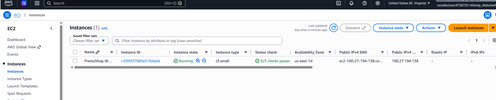
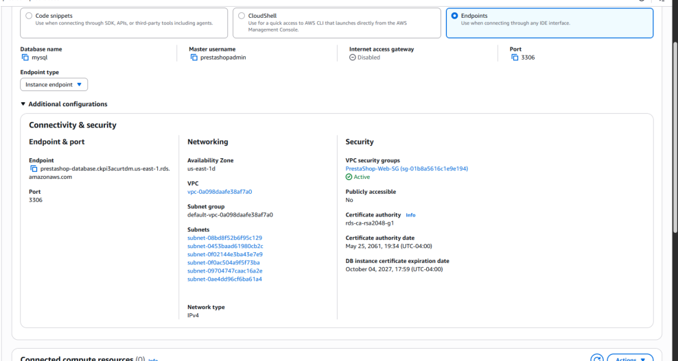
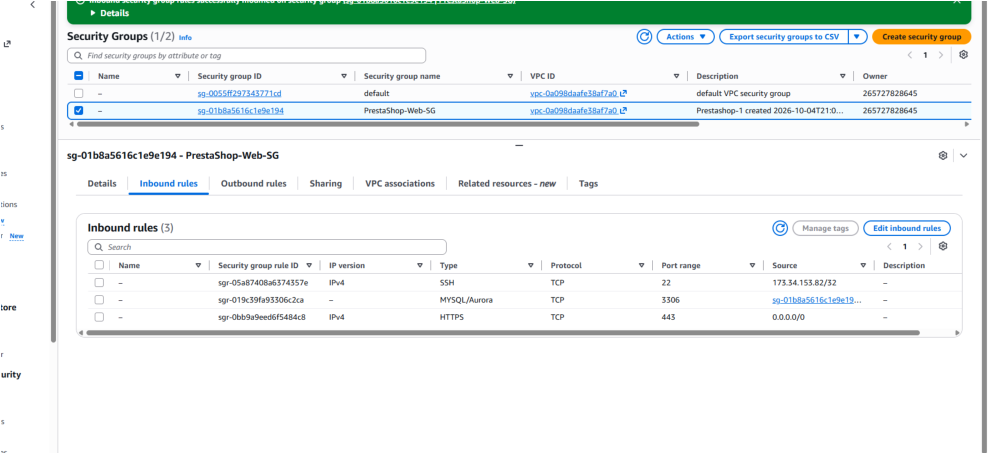
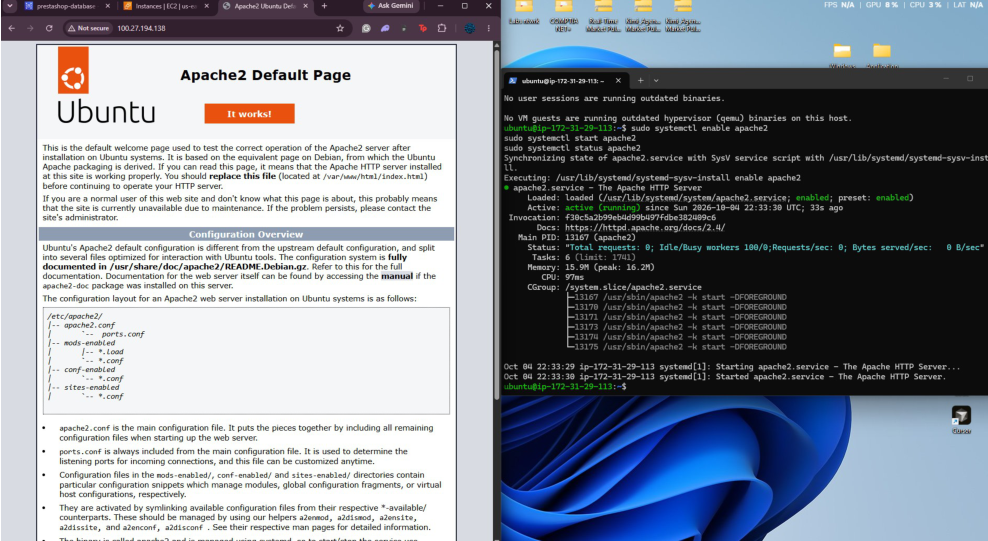
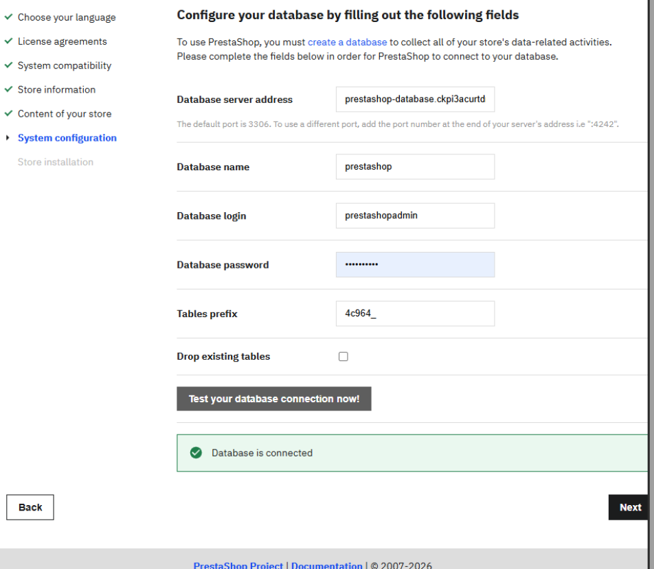
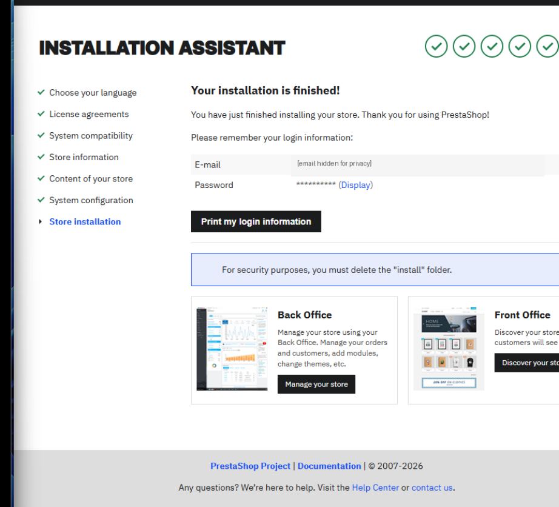
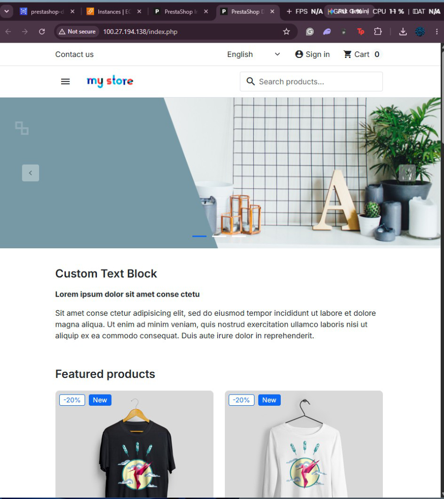

# Lab 01 — Secure PrestaShop Deployment on AWS

**Status:** Completed in an AWS Academy Learner Lab (October 2026).  
**Services:** Amazon EC2, Amazon RDS for MySQL, VPC security groups.  
**Stack:** Ubuntu, Apache, PHP, PrestaShop 9.2.0.

## Objective

Deploy a publicly accessible PrestaShop storefront on an Ubuntu EC2 instance while hosting its MySQL database separately on Amazon RDS. Apply network access restrictions and verify end-to-end application functionality.

## Architecture

```text
Internet users
    | HTTP / HTTPS (80 / 443)
    v
Amazon EC2 — Ubuntu + Apache + PHP + PrestaShop
    | MySQL (3306; security-group-restricted)
    v
Amazon RDS — MySQL (not publicly accessible)
```

> This diagram summarizes the reported lab setup. It is not an AWS-generated architecture diagram.

## Evidence and step-by-step walkthrough

### 1. EC2 instance and public IPv4 address


**Configuration / action:** The AWS EC2 console shows the Ubuntu web-server instance running and assigned a public IPv4 address.

**Observed result:** The web application has a compute host reachable through a public endpoint, subject to network rules.

**Security significance:** A public IP is appropriate for the lab storefront, while administrative access should remain restricted.

**Source:** Original lab report, figure 1 (PDF page 2).

### 2. RDS database network settings


**Configuration / action:** The Amazon RDS connectivity view shows MySQL on port 3306 with public accessibility disabled.

**Observed result:** The database is hosted separately from the web server and is not directly exposed as a public RDS endpoint.

**Security significance:** Separating application and database tiers reduces unnecessary external exposure.

**Source:** Original lab report, figure 2 (PDF page 3).

### 3. Security group access rules


**Configuration / action:** The configured network rules allow HTTP (80) and HTTPS (443) to the storefront, restrict SSH (22), and limit database access (3306) to the application security group.

**Observed result:** Web traffic can reach the application while administrative and database paths have narrower access.

**Security significance:** Security groups provide stateful network filtering; the rule scope matters more than merely opening a port.

**Source:** Original lab report, figure 3 (PDF page 4).

### 4. Apache service and default page


**Configuration / action:** The screenshot demonstrates the Apache service running on the EC2 instance and the default web page loading from its public IP.

**Observed result:** The EC2 network path and HTTP web server were functioning before the PrestaShop installation.

**Security significance:** Testing the base web stack independently helps isolate later application or database issues.

**Source:** Original lab report, figure 4 (PDF page 5).

### 5. PrestaShop database connection


**Configuration / action:** The PrestaShop installation assistant confirms that it can connect to the separate Amazon RDS MySQL database.

**Observed result:** Application-to-database connectivity succeeded using the RDS endpoint and configured database credentials.

**Security significance:** The application tier can communicate with a non-public database without exposing the database to the Internet.

**Source:** Original lab report, figure 5 (PDF page 7).

### 6. PrestaShop installation completed


**Configuration / action:** The installer displays a successful completion state for the PrestaShop deployment.

**Observed result:** The application installation finished after the database connection was validated.

**Security significance:** The report also documents removal of the install directory as post-installation cleanup; this is reported work, not a separate screenshot verification.

**Source:** Original lab report, figure 6 (PDF page 8).

### 7. Public PrestaShop storefront


**Configuration / action:** The PrestaShop front office loads in a browser through the EC2 public IP, displaying the installed demonstration storefront.

**Observed result:** At submission time, the web server, application, and RDS database operated together to serve the storefront.

**Security significance:** An end-to-end browser check validates more than an EC2 running state alone; the original public IP may no longer be active.

**Source:** Original lab report, figure 7 (PDF page 9).

## Implementation details

The report records the following package installation and Apache startup commands:

```bash
sudo apt update
sudo apt install -y apache2 php php-cli php-common php-curl php-gd php-intl php-mbstring php-mysql php-xml php-zip unzip wget
sudo systemctl enable apache2
sudo systemctl start apache2
```

PrestaShop was installed in `/var/www/html`, with Apache web-user ownership and file permissions configured. The installer used the Amazon RDS endpoint instead of `127.0.0.1`, and the database connection test passed.

After successful installation, the report records the following cleanup command, intended only for the completed PrestaShop installation directory:

```bash
sudo rm -rf /var/www/html/install
```

## Verification and outcomes

- EC2 web-server instance running with a public IP.
- RDS MySQL configured as non-public and separate from the web host.
- Apache default page accessible over HTTP.
- PrestaShop installer connected successfully to RDS.
- PrestaShop installation completed and front office loaded in the browser.

## Scope and limitations

- The public IPv4 address in the original report was temporary and **should not be treated as a current live demo**.
- The report lists HTTP and HTTPS network rules, but **does not independently establish that TLS certificates or HTTPS were configured and tested**.
- The deployment took place in a temporary AWS Academy environment, not a production service.
- The seven images are cropped from the original report; the report itself is included under `docs/` for traceability.
- Credentials and passwords are not reproduced in this README.

## Original evidence

[View the original submitted PDF report](docs/original-lab-report.pdf).
